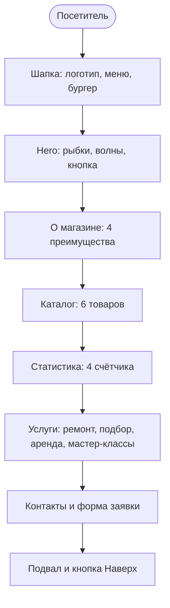
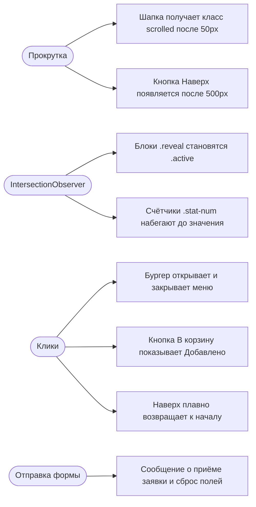
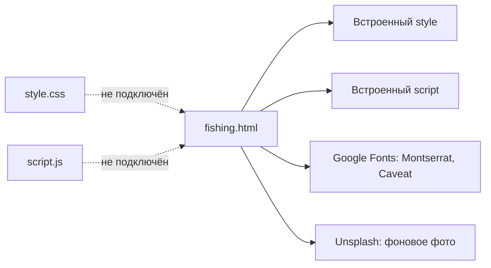

# 🎣 Клёвое место — сайт рыболовного магазина

Одностраничный статический сайт-визитка рыболовного магазина на чистом HTML, CSS и JavaScript. Без фреймворков и сборки: открыл `fishing.html` в браузере, и всё работает.

## 🚀 Функциональность
- [x] Адаптивный дизайн: ПК, планшет, телефон, бургер-меню
- [x] Фиксированная шапка, которая темнеет при прокрутке
- [x] Hero-экран с плавающими рыбками и бегущими волнами
- [x] Плавное появление блоков при скролле (IntersectionObserver)
- [x] Анимированные счётчики статистики
- [x] Каталог из 6 товаров, кнопка «В корзину» с обратной связью
- [x] Блок услуг, контакты и форма заявки
- [x] Кнопка «Наверх»

## 🧱 Технологии
HTML5, CSS3 (переменные, grid, flex, keyframes), JavaScript (ES6), шрифты Montserrat и Caveat (Google Fonts), фоновое фото с Unsplash.

## 📁 Структура проекта
```
fishingshop/
├── fishing.html   # сайт целиком: разметка, <style> и <script> внутри
├── style.css      # отдельная таблица стилей (темы, свет за курсором), пока не подключена
├── script.js      # отдельный скрипт (тема, калькулятор, заявки), пока не подключён
└── README.md
```
> Сейчас страница `fishing.html` использует собственные встроенные стили и скрипт. Файлы `style.css` и `script.js` лежат в репозитории, но к ней не подключены.

## 🗺️ Диаграммы проекта

### Структура страницы



### Что происходит в браузере



### Файлы и внешние ресурсы



## 🌿 Git-ветки
| Ветка | Назначение |
|-------|-----------|
| `main` | стабильная версия, из неё публикуется сайт |
| `development` | разработка новых блоков |
| `test` | эксперименты со стилями и скриптами |

## 🌐 GitHub Pages
Settings → Pages → Branch `main`, папка `/ (root)`. Чтобы сайт открывался по основному адресу, переименуйте `fishing.html` в `index.html`.
Адрес: `https://[your-username].github.io/[repo-name]`

## 📄 Лицензия
MIT
